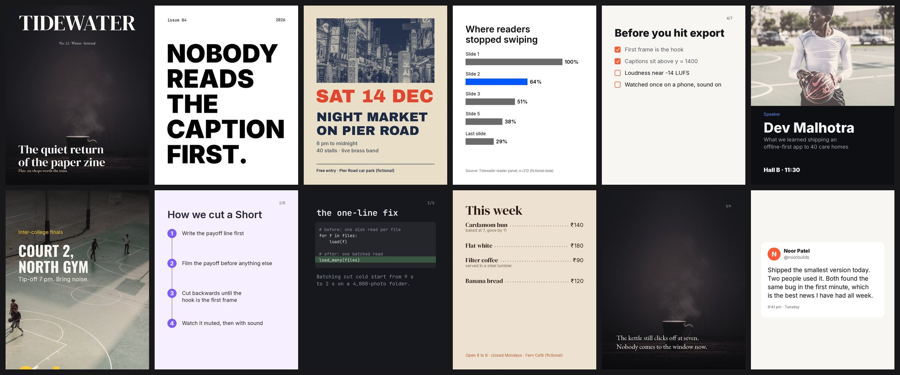

# Media Lab

[](https://github.com/HarshSalunkhe2005/Media-Lab/actions/workflows/ci.yml)
[](LICENSE)
[](https://gitdiagram.com/HarshSalunkhe2005/Media-Lab)

A content skill for coding agents, and the library behind it. It makes Shorts, Reels, carousels, LinkedIn
documents, stories, posts, thumbnails and event media that read as made by a person, and it **renders real files**:
PNG, PDF and MP4 from a short JSON brief, checked against each platform's spec before you post.

It is the media sibling of [UI Lab](https://ui-lab-weld.vercel.app).

**Live site:** https://media-lab-seven.vercel.app



## What you get

| | |
|---|---|
| **Procedure** | Brief → package → script → critique → edit → verify. Gated: the agent writes the brief and the hook before it touches a renderer. |
| **12 worlds** | Named styles with type, colour, imagery, motion and "avoid" rules: Quiet Poetry, Tech Launch, Campus Event, Explainer, Data Story, Build Log, Warm Local, Faceless Story, Editorial, Retro Print, Brutalist Mono, Soft Pastel. |
| **58 patterns** | Carousels, posts, stories, event media, thumbnails, hooks, captions, Shorts and reframes. Every preview is real output of the repo's own renderers. |
| **`medialab` CLI** | 24 still kinds + 7 video kinds from one JSON/YAML spec. Carousels export a LinkedIn-ready PDF. Fonts bundled, so output matches on every OS. |
| **`medialab check`** | Canvas, duration, codec, yuv420p, faststart, black opening, EBU R128 loudness and true peak, silent start, text in the app's UI zones, contrast at feed size. Exit code 1 on fail. |
| **Reference** | Format specs and safe zones, a hook library, critique rubric, taste smell test, tested ffmpeg / MoviePy / Remotion recipes, research with evidence levels. |

## Install

As a Claude Code plugin:

```
/plugin marketplace add HarshSalunkhe2005/Media-Lab
/plugin install media-lab@media-lab
```

By hand: copy [`plugins/media-lab/skills/media-lab`](plugins/media-lab/skills/media-lab) into `~/.claude/skills/`
(Windows: `%USERPROFILE%\.claude\skills\`), so `~/.claude/skills/media-lab/SKILL.md` exists. Works with any agent
that reads a `SKILL.md` folder. The renderer needs Python 3.10+ and `pip install pillow`; video also needs ffmpeg.

## Two minutes with the CLI

```bash
cd ~/.claude/skills/media-lab
python scripts/medialab example carousel > brief.json     # edit the words, point "photo" at your image
python scripts/medialab make brief.json -o out/           # out/01.png ... out/carousel.pdf
python scripts/medialab check out/01.png --platform carousel
```

```
out/01.png  ->  carousel

  PASS  canvas                   1080x1350
  PASS  contrast at 160 px       5-95% luma spread 203

  0 fail, 0 warn. Ship after a human watch-through.
```

`python scripts/medialab kinds` lists everything; [`recipes/medialab-cli.md`](plugins/media-lab/skills/media-lab/recipes/medialab-cli.md) is the reference.

## How it works

```
brief (you + playbook) ──► spec.json ──► medialab make ──► PNG / PDF / MP4 ──► medialab check ──► post
                              ▲                                                    │
         world (src/worlds.ts) + theme (medialab/themes.py)        formats/specs.md safe zones + limits
```

```
src/meta.ts            patterns: single source of truth (gallery, llms.txt, patterns.json, docs)
src/worlds.ts          12 worlds; src/router.ts maps a brief to a world and starting patterns
ai-index.ts            Vite plugin: generates the machine-readable files and fails the build on any drift
patterns/src/*.py      one renderer per pattern; newer ones are a spec passed to medialab.make.build
plugins/media-lab/     the skill: SKILL.md, playbook, formats, hooks, recipes, scripts/medialab, bundled fonts
tools/                 test_medialab.py (unit, CLI, video), build_skill.py (validated release zip)
research/              existing tools, what works (with evidence levels), teardown template
```

For agents: `/llms.txt`, `/llms-full.txt`, `/patterns.json`, `/worlds.json`, `/for-claude.md`, `/docs/<slug>.md`.

## Develop

```bash
npm install && npm run dev        # site on :5190
npm test                          # python tools/test_medialab.py (needs Pillow; ffmpeg for video tests)
python patterns/render.py <slug>  # re-render one preview
npm run build                     # fails on a missing preview, renderer, recipe path, unknown slug or index drift
npm run skill                     # release/media-lab-skill-<version>.zip
```

See [CONTRIBUTING.md](CONTRIBUTING.md) to add a pattern, kind, world or recipe.

## Rules

- Original content only. Study techniques; never copy scripts, footage, thumbnails or paid prompts.
- Examples use fictional names, teams and lines. Photos are CC0 / public domain only.
- Numbers need a source; vendor stats are treated as hypotheses (`research/02-what-works.md`).
- Every visual passes the AI-look smell test in `playbook/taste.md`.

MIT licensed. Fonts: SIL OFL 1.1. Photos: CC0.
